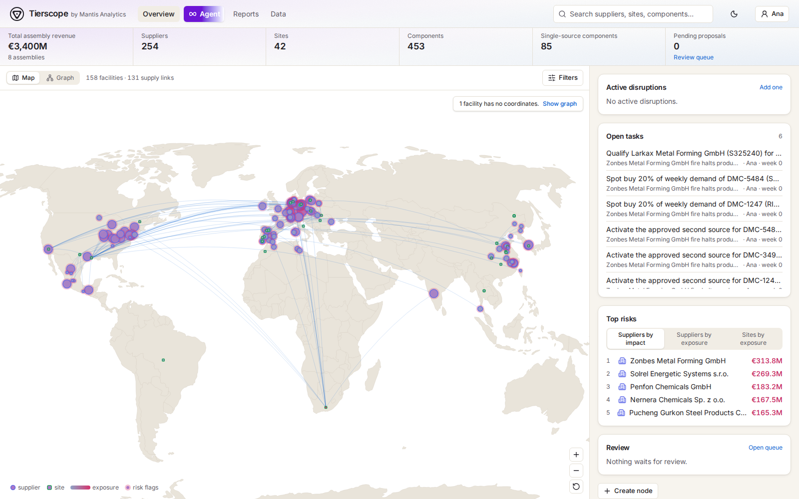
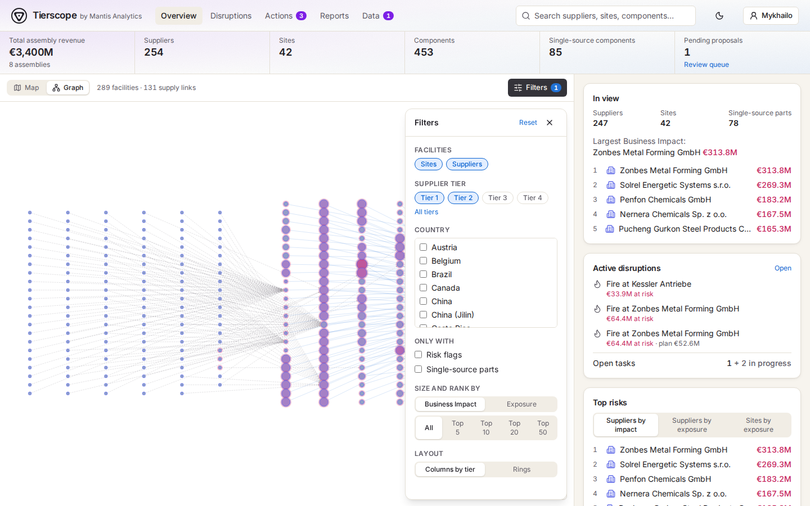
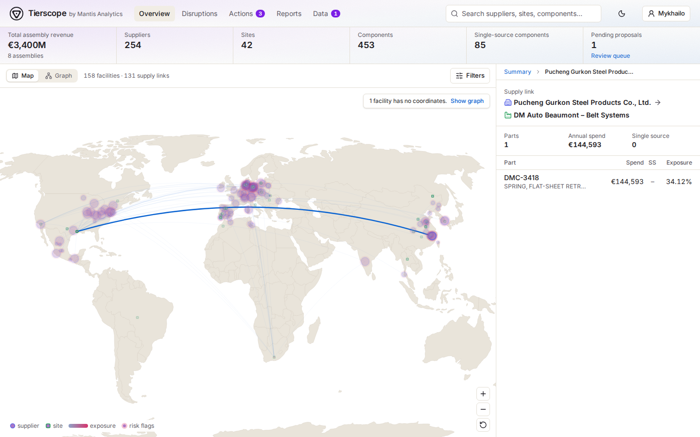
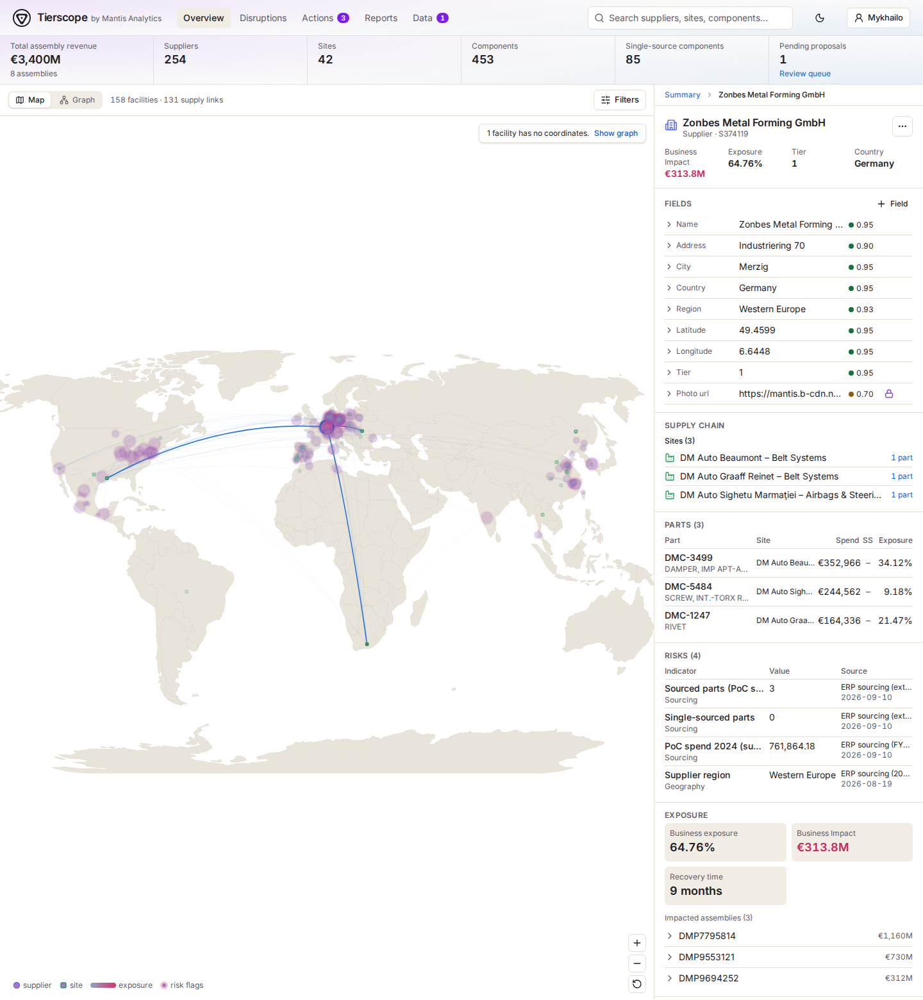
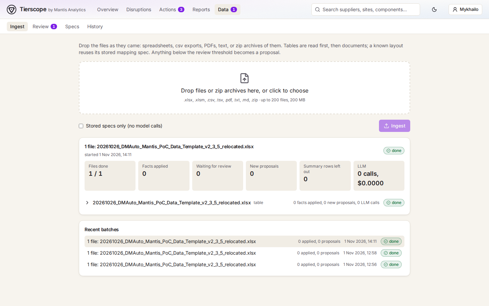
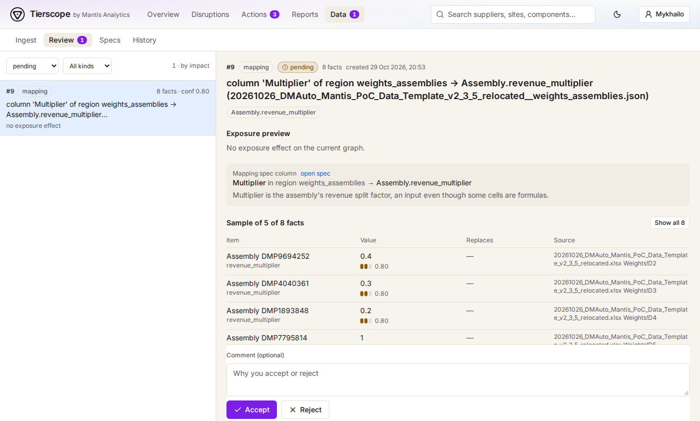

# Tierscope

**Which of your suppliers could stop your factories, how much money is at risk, and what do we do when one fails?**

A car is built from thousands of parts. Each part comes from a supplier, and those suppliers have suppliers of their
own (*tiers*). If one small supplier fails, every product that uses its part can stop, and nobody sees this from a
spreadsheet.

Tierscope reads your supplier, part and factory files (Excel, CSV, PDF, text) and builds a map of who supplies what to
whom. On that map it computes:

- **Business Exposure**: the share of a company's output that depends on one supplier, site or part.
- **Business Impact**: the same risk in euros.

When something goes wrong (a supplier fire, a closed shipping lane, a tariff, a chip shortage), Tierscope shows what it
costs if nobody acts. Then **Meta's Muse models**, acting as supply manager, investigate the graph, test plans in a
weekly simulator and propose a response. A person accepts or rejects every action. Accepted actions become tasks, and
each disruption ends in a report.

```
 Data in --> Network and exposure --> Disruption --> Agent plans --> People decide --> Tasks --> Report
```

## Built on Meta

| Model | How Tierscope uses it |
|---|---|
| **Muse Spark** (Meta Model API) | Default model. It maps new spreadsheet layouts, reads documents and alerts, answers questions about the network and plans responses to disruptions. |
| **Muse Glimmer** (open weights, self-hosted with vLLM) | The same agent on Meta's open-weights model on our own GPU. The planner's tools were reshaped from its traces, and both benchmarks below are run on it. |

Every model call goes through one gateway (`scgraph.llm`). Switching models takes one setting and needs no code change.
The gateway also caches responses, logs the cost of every call and stops at a spend cap you set.

## Quickstart

You need [uv](https://docs.astral.sh/uv/getting-started/installation/), which also installs Python, and a Meta Model
API key.

```bash
git clone https://github.com/MantisAnalytics/tierscope-supply-chain.git && cd tierscope
uv sync
cp .env.example .env        # set MODEL_API_KEY=<your Meta key>
uv run scgraph serve        # open http://127.0.0.1:8000
```

The app starts with an empty graph. Open **Data** and drop your supplier, part and site files: spreadsheets, CSV exports,
PDFs, or zip archives of them. Muse Spark maps each new layout once, and plain code then reads every row. The workbook we
developed on belongs to a customer and is not published.

## What the app does

| Part | What it does |
|---|---|
| **Data** | Reads spreadsheets, CSV, PDFs, text and zip archives of them. A model maps each new layout once, and plain code reads every row. |
| **Review** | Facts the model is unsure of wait for a person, with a preview of how exposure and impact would change. |
| **Network** | The map and tiered graph of factories, suppliers and parts, with Business Exposure and Business Impact for each, filters, supply chains and the source of every value. |
| **Disruptions** | Supplier outages, route closures, tariffs and chip shortages, entered with a form, picked from a ready library, pasted from a news alert or read from a document. Each is simulated week by week: stock cover, supply and BOM bottlenecks. |
| **Agent** | One engine that people talk to and that events start. As planner it investigates the graph, tests plans in the simulator and submits one. Every write (a plan, a graph edit, a draft disruption) passes an approval gate, and a person accepts or rejects each action with a comment the next plan version follows. |
| **Tasks and reports** | Accepted actions become tasks. A resolved disruption becomes a report of what it would have cost, what the plan cost and what the model cost. Portfolio risk, the agent scorecard and the benchmark are under Reports. |

## How it looks

**Overview** is the home page: key figures on top, the network of factories and suppliers in the centre, and a side
panel with active disruptions, open tasks and the top risks. Marker size is Business Impact, colour runs from slate
blue to rose with exposure, and a rose halo marks suppliers with risk flags.



The same network as a graph, with suppliers in columns by tier and the filters open (tier, country, risk flags,
single-source parts, the ranking metric and top N):



Click a supply link to see every part that travels along it, with spend, single-source flag and exposure:



Select a supplier to see its whole chain, tier-2 and tier-3 suppliers included. The side panel lists the chain by tier,
the supplier's parts, risk indicators, exposure, and every field with its source:



**Agent** is one place to work with the model, from a first question or a pasted alert to a resolved disruption.
- **Left:** disruptions waiting for you, marked with the reason (plan ready, task overdue), with conversations below.
- **Middle:** the thread. Each answer shows one card (a plan, an edit or a draft), with its steps folded.
- **Right:** the incident: cost if nothing is done, the weekly loss, the current plan and its tasks.

A plan lists its actions grouped by part, each with its cost and reason. Rejecting an action with a comment offers to ask
for a new version, and the agent writes it with that comment in mind.

**Data** takes spreadsheets, CSV exports, PDFs or zip archives of them:



**Review** (under Data): the model is not trusted blindly. Anything it is unsure about waits here, with a preview of how
the risk numbers would change, and a person accepts or rejects it.



## The agent

The planner is a tool-using loop (`src/scgraph/agent/`) over a `World`: the current week, what is known about the
disruption, simulation on that view, and the graph. Its tools are graph questions, `disruption_overview`,
`component_details`, `alternative_suppliers`, `simulate_plan` and `submit_plan`. Every step is recorded and shown live.

The tools are shaped for a smaller open-weights model:
- simulation names the assemblies each short part blocks, and can fill every gap in one call;
- a simulated plan is submitted by its id instead of being copied;
- a plan dearer than one already simulated is sent back once;
- lookups take several parts at once.

Details: [operations, The agent](docs/operations.md#the-agent).

## Benchmarks: the agent on Muse Glimmer

Both benchmarks run the final planner (agent v4) on Meta's open-weights **Muse Glimmer**, self-hosted, and score
every plan in the weekly simulator. The planner was developed on separate dev and tune cases. The test cases below
were run once, with the final code.

**Agent benchmark.** One disruption, known in full at week 0: 22 test disruptions drawn from the graph (supplier
outages, export restrictions, route closures, tariffs and supply shortages), 3 runs each. Skill is the share of the
optimiser's saving against doing nothing (1 = optimiser).

| | Skill [95% interval] | Total cost over the cases, EUR M |
|---|---|---|
| **Muse Glimmer, agent v4** | **0.98 [0.96, 1.00]** | **104** |
| Rule-based playbook | 0.84 | 166 |
| Do nothing / optimiser | 0 / 1 | 823 / 49 |

All 66 runs submitted a valid plan. The largest gain is on tariffs, where the agent scores 0.98 against the
playbook's 0.46.

**Episode benchmark.** A year at a time from **ShockBench-Flow**'s public generator, used unchanged: tariffs, power
shortages, raw material outages, port stoppages and weather closures, some announced weeks ahead, some decoys that
never happen. The events are mapped by geography onto the suppliers and shipping lanes of our development dataset.
The planner reviews its plan as news arrives, seeing only what is known that week. The plan in force is then scored
on what really happened with ShockBench's pooled Resilience Skill Score: 0 is doing nothing, 1 is the plan made by an
optimiser that knew the whole year.

| 100 test episodes | Score [90% interval] | Total cost, EUR M |
|---|---|---|
| **Muse Glimmer, agent v4** | **0.96 [0.94, 0.97]** | **279** |
| Informed re-planner (the optimiser on each week's view) | 0.94 [0.92, 0.96] | 455 |
| Rule-based playbook, reacting when hit | 0.90 [0.86, 0.93] | 824 |
| Do nothing / plan made knowing the whole year | 0 / 1 | 7,692 / 61 |

The agent is at least as good as the playbook in 86% of the test episodes. On the dev (20) and tune (40) episodes it
was developed on, it scored 0.96 and 0.97. Before the tools were reshaped from Glimmer's traces, the same model scored
about 0.77 on test.

The suites and per-run files are built on the customer's graph, so only the summaries are published
(`benchmarks/results/`, `benchmarks/episode_results/`; also Reports, Agent benchmark). To build and run the same
benchmarks on your own graph, use `scgraph ops suite` and `scgraph ops bench`, then `scgraph ops episodes-suite` and
`scgraph ops episodes-bench`. Method, every mapping assumption and results by type and harm level:
[operations](docs/operations.md#agent-benchmark).

## How it works

1. **Ingest:** a model reads the file's layout and writes a mapping (which column is a supplier name, which is a
   weight, and so on). Plain code applies it to every row. Known layouts are reused with no model call.
2. **Review:** confident facts go straight into the graph, and uncertain ones become proposals for a person to decide.
3. **Explore:** every value keeps its source cell or document quote, its confidence and its history, and every change
   can be undone.
4. **Respond:** a disruption is simulated week by week on the graph. The agent tests plans in the same simulator and
   proposes one, people decide, and tasks and reports follow. Rules, costs and results:
   [operations](docs/operations.md).

The graph is a SQLite file (`.cache/graph.sqlite`; set `SCGRAPH_GRAPH_DB` to move it).

## Command line

```bash
uv run scgraph ingest data/<workbook>.xlsx          # model-written mapping; --reuse-only = no model calls
uv run scgraph ingest exports.zip bom.csv contract.pdf  # a batch: tables first, then documents, a report each
uv run scgraph graph stats | show Supplier <supplier-id> | schema
uv run scgraph exposure top Supplier -n 10          # biggest risks; also: show, check
uv run scgraph proposals list --sort impact         # also: show, accept ID, reject ID
uv run scgraph edit set_field Site <site-id> recovery_time_months 9
uv run scgraph journal                              # every change; --undo ID reverts one
uv run scgraph ops library --save 1                 # a ready disruption for this graph
uv run scgraph ops plan 1                           # the agent's response plan; also: assess, report, list
uv run scgraph ops episodes-suite                   # map ShockBench years onto your graph
uv run scgraph ops episodes-bench --split dev       # the planner through those years (calls the model)
```

Edits made by a person apply at once and are never overwritten by a later load (a disagreeing value becomes a
proposal). They may carry evidence (`scgraph evidence add file.pdf`). Every command and setting is in the
[manual](docs/manual.md).

## LLM configuration

Copy `.env.example` to `.env`. Real environment variables take precedence.

| Variable | Default | Meaning |
|---|---|---|
| `SCGRAPH_LLM_PROVIDER` | `meta` | `meta` (Muse Spark) or `glimmer` (self-hosted Muse Glimmer) |
| `MODEL_API_KEY` | | Meta Model API key |
| `MUSE_API_KEY` / `MUSE_BASE_URL` | / `http://localhost:8000/v1` | Key and address of your Muse Glimmer server ([manual](docs/manual.md#providers)) |
| `SCGRAPH_LLM_CACHE` | `record` | `record`: cache, and call on a miss; `replay`: cache only, no keys needed; `off` |
| `SCGRAPH_BUDGET_META_USD` / `_GLIMMER_USD` | `5` / `5` | Spend cap per provider |
| `SCGRAPH_REVIEW_THRESHOLD` | `0.9` | Confidence at or above which facts skip review |

`uv run scgraph llm spend` shows spend per model.

## API and web app

`scgraph serve` also serves a local FastAPI with docs at <http://127.0.0.1:8000/docs>. It has no authentication, so run
it on your own machine. The author of a change is the `X-Author` header.

The UI is in `ui/` (React, Vite, TypeScript). Its build is committed in `src/scgraph/api/static/`, so running the app
needs only `uv`. To change the UI you need Node 20+:

```bash
cd ui && npm install
npm run dev        # http://localhost:5173, proxies /api to :8000
npm test           # Vitest
npm run build      # build into src/scgraph/api/static/ (commit it)
```

Tests: `uv run pytest`. They need no network and no keys.

## Built during the hackathon vs. what existed before

What existed before October 27, 2026:
- [ShockBench-Flow](https://pypi.org/project/shockbench-flow/) 0.1.2, Mantis Analytics' semiconductor-network
  benchmark. It is used unchanged as the source of the chip-shortage curves (`benchmarks/shockbench.json`) and of the
  episode benchmark's events (`benchmarks/shockbench_episodes.json.gz`). Both are exported by the scripts in
  [`benchmark/`](benchmark/README.md).
- The customer's data-capture template (an automotive supplier workbook) and its Business Exposure and Business Impact
  formulas, which `src/scgraph/exposure/` reproduces. The workbook itself is not in this repository.

Everything in this repository was built during the hackathon, from October 27 to November 4, 2026:
- Tierscope itself: ingest, review, the graph, exposure and the web app;
- operations: disruptions, the weekly simulator, the response agent, decisions, tasks and reports;
- the benchmark and the ShockBench exporter scripts.

## License

[MIT](LICENSE)
